# Creating Google App

## Overview

To use the Google Calendar Extension, you must create a Google Cloud project and configure OAuth 2.0 credentials. This guide provides step-by-step instructions for setting up your Google application with the necessary permissions and credentials.

## Prerequisites

- Google account with access to Google Cloud Console
- Administrative permissions to create projects and configure APIs
- Basic understanding of OAuth 2.0 authentication

## Step-by-Step Instructions

### 1. Access Google Cloud Console

Login to the Google Cloud Console at [https://console.cloud.google.com/getting-started](https://console.cloud.google.com/getting-started)

### 2. Create or Select Project

1. **Select Project**: At the top left-hand side panel, click "Select a project"

   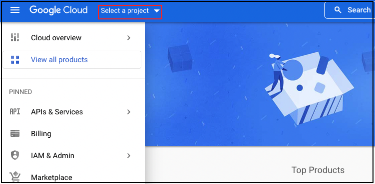

2. **Choose Existing or Create New**: A pop-up window will be displayed. Select a project from available projects if you have already created one, otherwise click "New Project"

   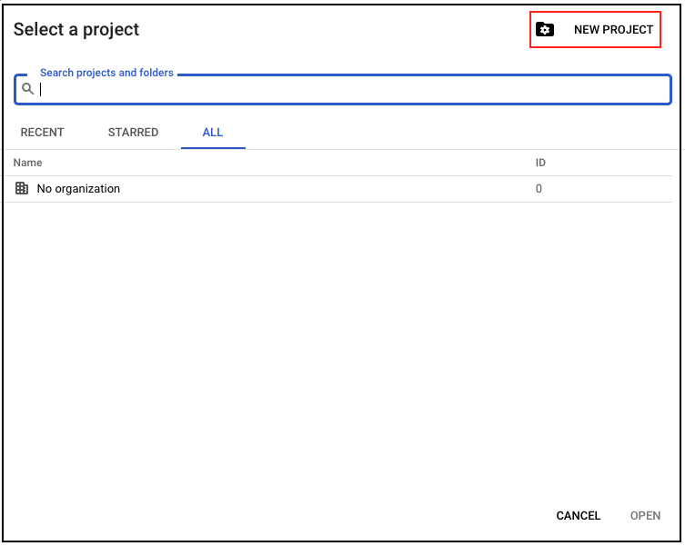

3. **Configure Project**: Set up the Project name and Organization, then click "CREATE"

   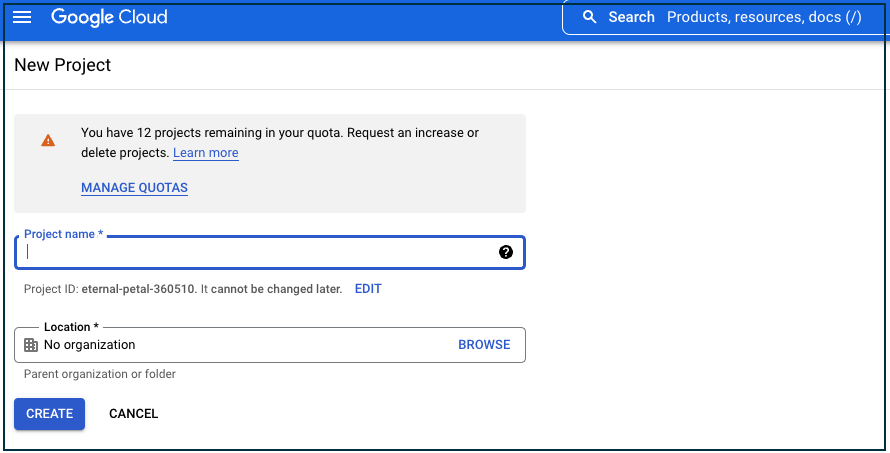
  
### 3. Enable Google Calendar API

1. **Navigate to APIs & Services**: Select your project, click on the sidebar, then click "APIs and services" → "Enabled APIs and services"

   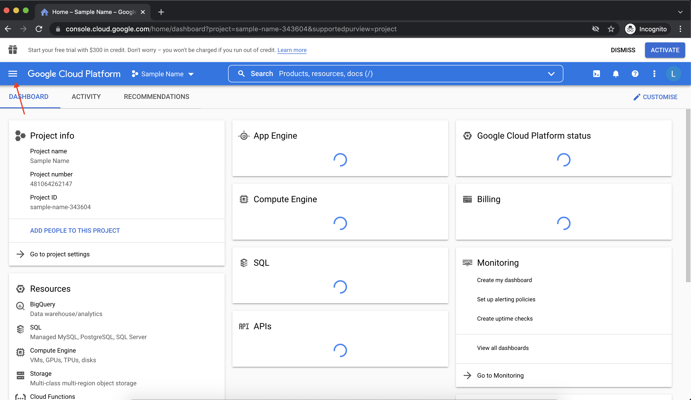

   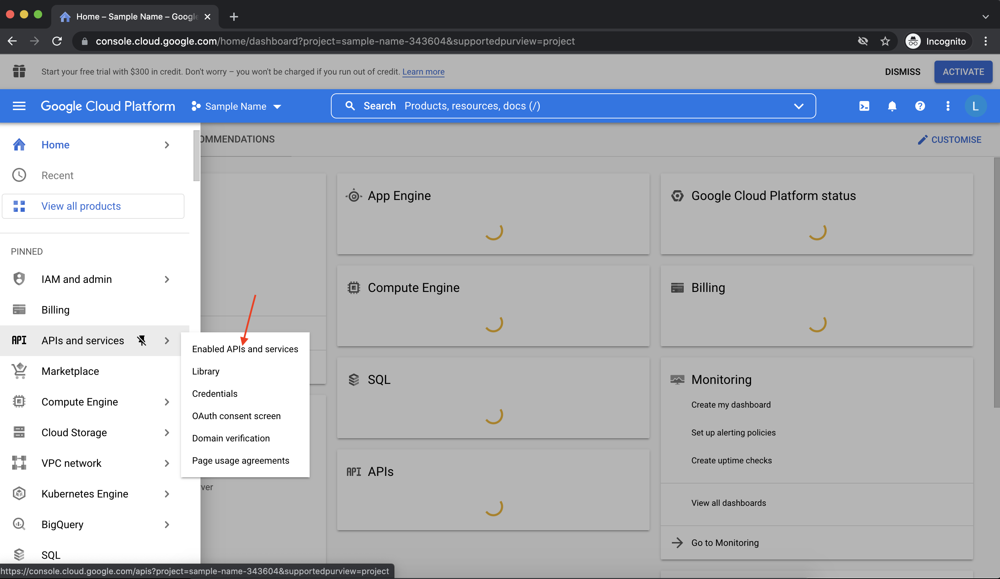

2. **Enable Calendar API**: Click "+ ENABLE APIS AND SERVICES" and search for "Google Calendar API"

   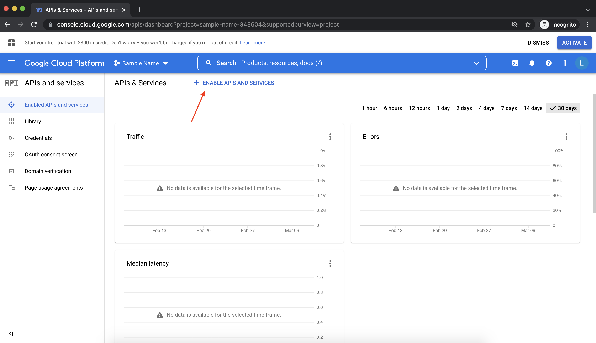

   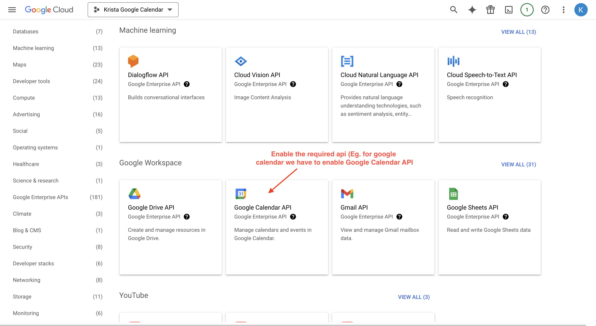

### 4. Configure OAuth Consent Screen

1. **Access Consent Screen Configuration**
   - Go to **APIs & Services** > **OAuth consent screen**
   - Choose **External** for public applications or **Internal** for Google Workspace domains

   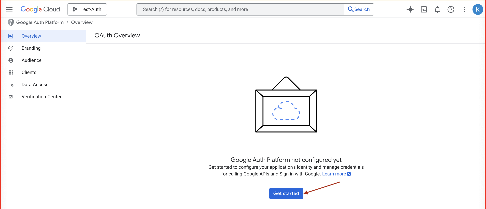

2. **App Information**
   - **App name**: Enter a user-friendly name (e.g., "Krista Google Docs Extension")
   - **User support email**: Your support email address
   - **App logo**: Optional but recommended for user trust
   - **App domain**: Your organization's domain (if applicable)

   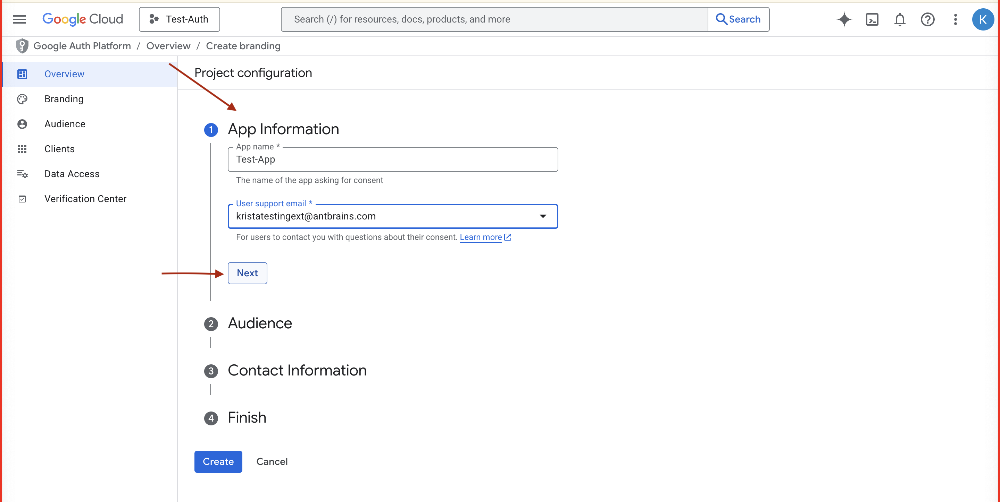

3. **Authorized Domains**
   - Add your Krista server domain
   - Include any additional domains that will host the application

4. **Contact Information**
   - **Developer contact information**: Email for Google to contact you
   - This is required for app verification

   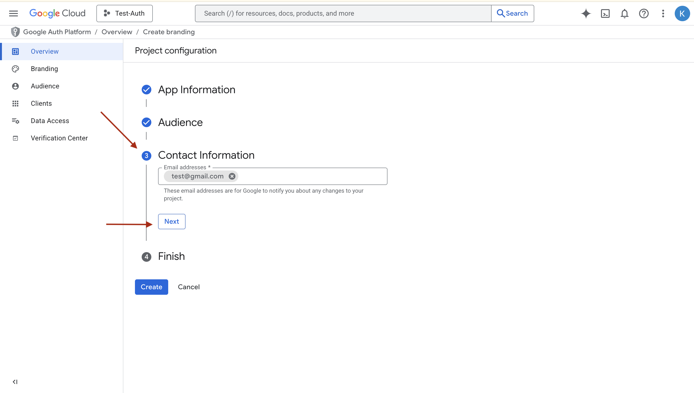

5. **Save and Continue**
   - Review all information
   - Click **SAVE AND CONTINUE**

### 5. Configure Scopes

1. **Add Calendar Scope**: On the Scopes page, click "ADD OR REMOVE SCOPES"

2. **Search for Calendar**: Search for "calendar" and select the Google Calendar API scope:
   - `https://www.googleapis.com/auth/calendar`

   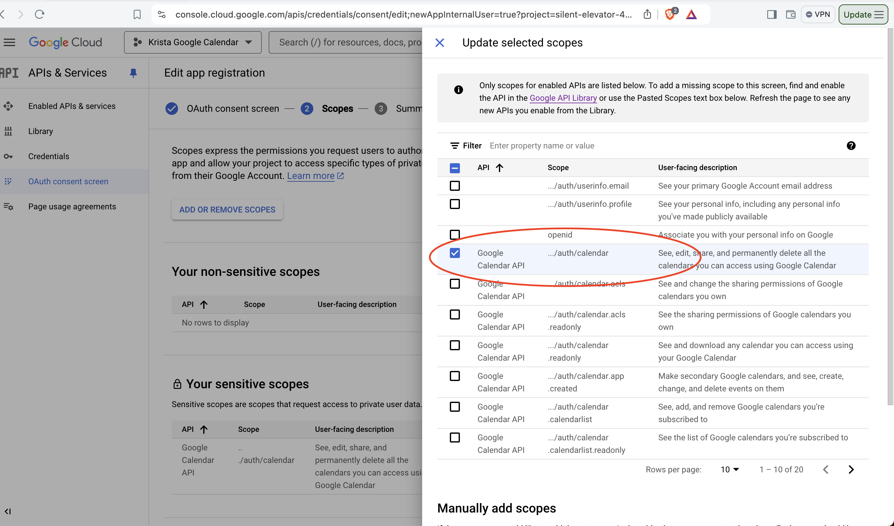

3. **Save Scopes**: Click "UPDATE" to save the selected scopes

4. **Continue Setup**: Click "SAVE AND CONTINUE" to proceed

### 6. Configure Test Users (if External)

1. **Add Test Users**: If you selected "External" user type, add test user email addresses

   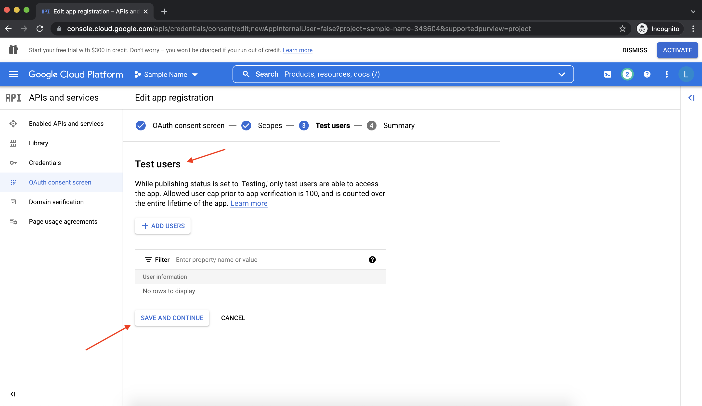

2. **Review Summary**: Complete the setup and review the application summary

   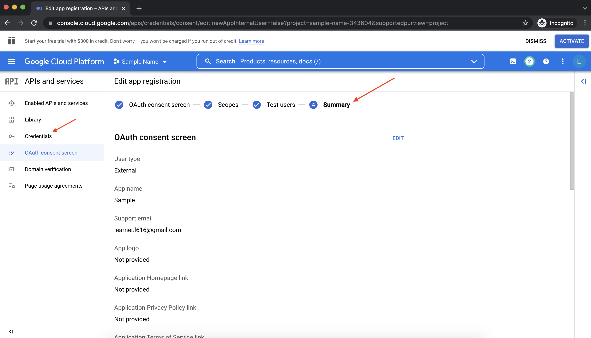
  

### 7. Create OAuth Credentials

1. **Access Credentials**: Click on "Credentials" in the left sidebar

2. **Create Credentials**: Click "+ CREATE CREDENTIALS" and select "OAuth client ID"

   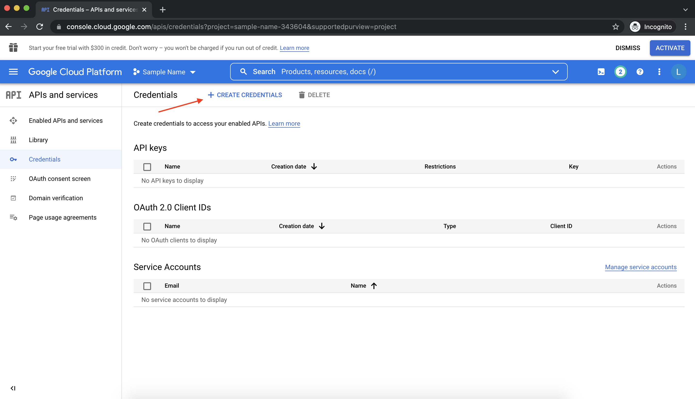

   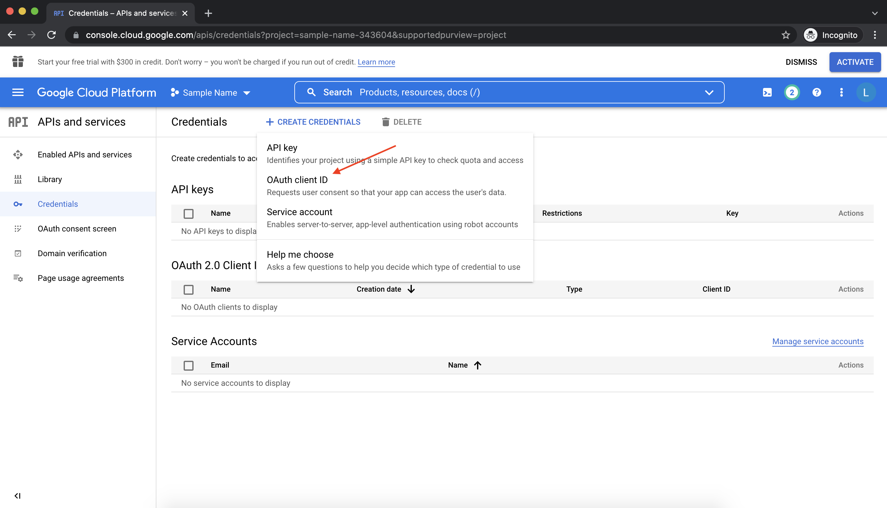

3. **Configure Application Type**: Select "Web application" as the application type

   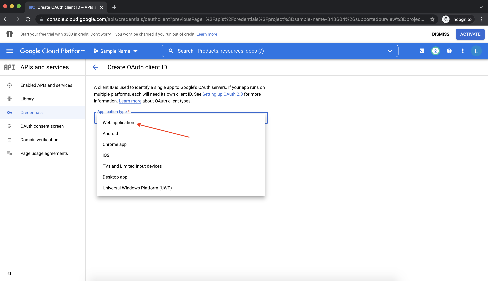

4. **Set Authorized Redirect URIs**: Add the redirect URI for your Krista extension:
   - Format: `https://your-krista-instance.com/routing-id/rest/googlecalendar/callback`
   - Replace `your-krista-instance.com` with your actual Krista domain
   - Replace `routing-id` with your extension's routing ID

   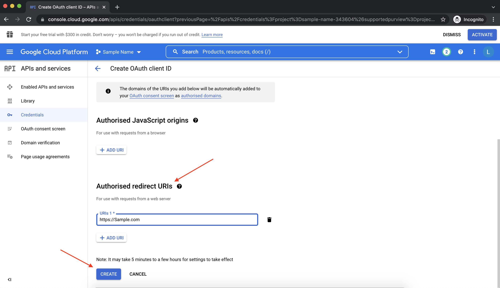

5. **Create Credentials**: Click "CREATE" to generate your OAuth credentials

   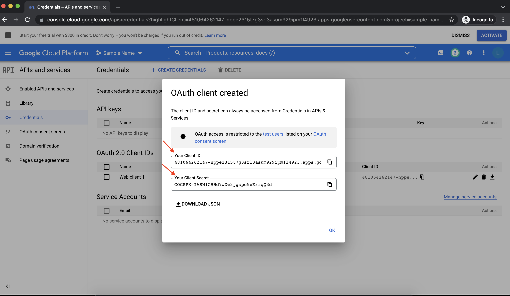

6. **Save Credentials**: Copy and securely store your Client ID and Client Secret

## Verification

### Verify Setup is Correct

1. **Check API Status**: Confirm Google Calendar API is enabled in your project
2. **Verify Consent Screen**: Ensure OAuth consent screen is properly configured
3. **Validate Credentials**: Confirm OAuth client ID is created with correct redirect URI
4. **Test Scopes**: Verify calendar scope is added and approved

### Security Considerations

1. **Credential Security**: Store Client ID and Client Secret securely
2. **Redirect URI**: Ensure redirect URI matches exactly (including protocol and path)
3. **Scope Limitation**: Only request necessary calendar permissions
4. **Regular Review**: Periodically review and rotate credentials

## Next Steps

1. **Configure Extension**: Use the Client ID and Client Secret in your Google Calendar Extension setup
2. **Set Email**: Configure the email address for service account authentication
3. **Test Connection**: Use the extension's test connection feature to verify setup
4. **Complete Authentication**: Follow the [Authentication](Authentication.md) guide for OAuth flow details

## Troubleshooting

### Common Setup Issues

#### API Not Enabled
**Symptoms**: "API not enabled" errors
**Resolution**: Ensure Google Calendar API is enabled in your project

#### Invalid Redirect URI
**Symptoms**: "redirect_uri_mismatch" errors
**Resolution**: Verify redirect URI matches exactly in both Google Console and extension configuration

#### Consent Screen Issues
**Symptoms**: "OAuth consent screen not configured" errors
**Resolution**: Complete OAuth consent screen setup with required information

#### Scope Problems
**Symptoms**: "Insufficient permissions" errors
**Resolution**: Ensure calendar scope is properly added and approved

## See Also

- [Extension Configuration](/pages/ExtensionConfiguration.md) - Configure the extension with your credentials
- [Authentication](/pages/Authentication.md) - Complete OAuth 2.0 authentication flow
- [Troubleshooting](../README.md#support--resources) - Additional support resources
