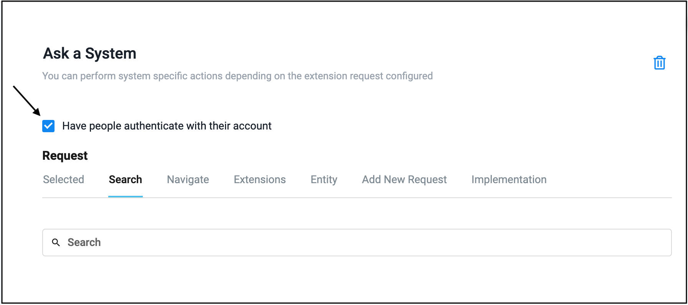

# Authentication

## Overview

The Google Calendar Extension uses OAuth 2.0 authentication to securely access Google Calendar APIs. The extension supports two authentication modes: Service Account Authentication for system-level operations and User Account Authentication for individual user access.

## Authentication Modes

### Service Account Authentication

**When to Use**:
- System-level calendar operations
- Automated workflows without user interaction
- Centralized calendar management

**Configuration**:
- Uncheck "Have people authenticate with their account" checkbox
- Uses the configured email address from extension setup
- Operates under a single Google account context


**Benefits**:
- No user interaction required during execution
- Consistent permissions and access
- Suitable for background processes

### User Account Authentication

**When to Use**:
- Individual users need access to their personal calendars
- User-specific calendar operations
- Multi-tenant scenarios

**Configuration**:
- Check "Have people authenticate with their account" checkbox
- Each user authenticates with their own Google account
- Personalized calendar access per user



**Benefits**:
- User-specific calendar access
- Personalized permissions
- Individual consent and control

## OAuth 2.0 Scopes and Permissions

### Required Scopes

The extension requires the following Google Calendar API scope:

| Scope | URL | Permission Level | Description |
|-------|-----|------------------|-------------|
| Calendar | `https://www.googleapis.com/auth/calendar` | Read/Write | Full access to calendar events, attendees, and metadata |

### Permission Details

**What this scope allows**:
- Create, read, update, and delete calendar events
- Manage event attendees and invitations
- Access calendar metadata and settings
- Respond to meeting invitations

**Alternative Scopes**:
- `https://www.googleapis.com/auth/calendar.readonly` - Read-only access (not used)
- `https://www.googleapis.com/auth/calendar.events` - Events only (not used)

**Why full calendar scope is required**:
The extension needs comprehensive calendar access to support all catalog requests including event creation, attendee management, and invitation responses.

## OAuth 2.0 Grant Types

### Authorization Code Grant

- **Grant Type**: `authorization_code`
- **Used For**: Initial authentication and authorization
- **Flow**: User consent → Authorization code → Access token

**Request Example**:
```http
GET https://accounts.google.com/o/oauth2/auth?
  client_id=123456789.apps.googleusercontent.com&
  redirect_uri=https://your-instance.com/routing-id/rest/googlecalendar/callback&
  scope=https://www.googleapis.com/auth/calendar&
  response_type=code&
  access_type=offline&
  prompt=consent
```

**Response Example**:
```json
{
  "access_token": "ya29.a0AfH6SMC...",
  "refresh_token": "1//04...",
  "token_type": "Bearer",
  "expires_in": 3600,
  "scope": "https://www.googleapis.com/auth/calendar"
}
```

### Refresh Token Grant

- **Grant Type**: `refresh_token`
- **Used For**: Token refresh without user interaction
- **Flow**: Refresh token → New access token

**Request Example**:
```http
POST https://oauth2.googleapis.com/token
Content-Type: application/x-www-form-urlencoded

client_id=123456789.apps.googleusercontent.com&
client_secret=GOCSPX-abcdefghijklmnopqrstuvwxyz&
refresh_token=1//04...&
grant_type=refresh_token
```

**Response Example**:
```json
{
  "access_token": "ya29.a0AfH6SMD...",
  "token_type": "Bearer",
  "expires_in": 3600,
  "scope": "https://www.googleapis.com/auth/calendar"
}
```

## Authentication Flow

### Initial Authentication Process

1. **User Initiates**: User triggers a catalog request requiring authentication
2. **Authorization Check**: Extension checks for valid access token
3. **Redirect to Google**: If no token, redirects to Google OAuth consent screen
4. **User Consent**: User grants permission to access their calendar
5. **Authorization Code**: Google redirects back with authorization code
6. **Token Exchange**: Extension exchanges code for access and refresh tokens
7. **Token Storage**: Tokens are securely stored for future use
8. **Request Execution**: Original catalog request is executed with valid token

### Authorization Code Exchange

The extension handles the OAuth callback and exchanges the authorization code:

```java
// Simplified flow representation
String authorizationCode = request.getParameter("code");
OAuth20Service service = createOAuthService();
OAuth2AccessToken accessToken = service.getAccessToken(authorizationCode);
storeTokens(accessToken);
```

## Token Management

### Access Token Lifecycle

**Expiration Time**: 1 hour (3600 seconds)
**Automatic Refresh**: Yes, handled transparently
**Storage**: Temporarily cached in memory
**Security**: Never logged or persisted long-term

### Refresh Token Lifecycle

**Verified Apps**:
- Refresh tokens do not expire automatically
- Valid until user revokes access or changes password

**Unverified Apps**:
- Refresh tokens expire after 7 days of inactivity
- Requires re-authentication after expiration

**Storage**: Securely encrypted in extension database
**Usage**: Automatically used to refresh access tokens

### Token Refresh Flow

1. **Access Token Expires**: API request returns 401 Unauthorized
2. **Automatic Refresh**: Extension uses refresh token to get new access token
3. **Retry Request**: Original API request is retried with new token
4. **Transparent to User**: No user interaction required

## Token Expiration Scenarios

### Access Token Expiration

**Cause**: Normal expiration after 1 hour
**Handling**: Automatic refresh using refresh token
**User Impact**: None - transparent refresh
**Error Recovery**: Automatic retry of original request

### Refresh Token Expiration

**Causes**:
- User revokes application access
- Password change or security event
- Inactivity timeout (unverified apps)
- Google security policies

**Handling**:
- Extension detects invalid refresh token
- Throws `MustAuthorizeException`
- User prompted to re-authenticate

**Error Messages**:
- "Refresh token expired: Authentication credentials are no longer valid. Required: Fresh OAuth authorization. Resolution: Re-authenticate by clicking 'Validate Attributes' and completing the Google OAuth flow."
- "Authorization required: Extension needs Google Calendar permissions. Required: Valid OAuth credentials. Resolution: Click 'Validate Attributes', complete Google OAuth flow, then save configuration changes."

### Token Revocation Scenarios

**User Revocation**:
- User removes app access in Google Account settings
- Immediate token invalidation
- Requires complete re-authentication

**Security Events**:
- Suspicious activity detection
- Account compromise indicators
- Automatic token revocation by Google

**Token Limits**:
- Google limits total refresh tokens per user/app
- Oldest tokens may be invalidated when limits exceeded

## Security Best Practices

### 1. Token Security
- Access tokens are never logged or stored permanently
- Refresh tokens are encrypted at rest
- All token transmission uses HTTPS
- Tokens are scoped to minimum required permissions

### 2. Authentication Security
- PKCE (Proof Key for Code Exchange) support
- State parameter validation to prevent CSRF attacks
- Secure redirect URI validation
- Protection against authorization code interception

### 3. Session Management
- Automatic token cleanup on extension shutdown
- Regular token validation and refresh
- Secure handling of authentication state

## Troubleshooting Authentication

### Common Authentication Errors

#### "Invalid Client" Error
**Cause**: Incorrect Client ID or Client Secret
**Resolution**: Verify credentials in Google Cloud Console

#### "Redirect URI Mismatch"
**Cause**: Configured redirect URI doesn't match Google Console
**Resolution**: Update redirect URI in Google Cloud Console

#### "Access Denied"
**Cause**: User declined permission or insufficient scope
**Resolution**: Re-authenticate and grant required permissions

#### "Token Expired"
**Cause**: Refresh token is invalid or expired
**Resolution**: Complete re-authentication flow

### Authentication Debugging

1. **Check Extension Logs**: Review authentication-related log entries
2. **Verify Configuration**: Confirm Client ID, Secret, and redirect URI
3. **Test OAuth Flow**: Use Google OAuth Playground for testing
4. **Validate Scopes**: Ensure required scopes are granted

## See Also

- [Extension Configuration](/pages/ExtensionConfiguration.md) - Setup and configuration details
- [Creating Google App](/pages/CreatingGoogleApp.md) - Google Cloud Console setup
- [Troubleshooting](../README.md#support--resources) - Additional support resources
